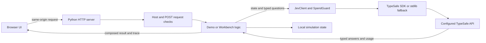

# Architecture

Jev Lab is a local web application. One Python process serves static pages, accepts JSON API
requests, holds simulation state, and calls TypeSafe through a shared client. The frontend uses
native JavaScript modules and browser APIs; no compilation is required.

## Request flow

[`server.py`](../server.py) defines page mappings, JSON routes, key onboarding, and the HTTP
handler. Served pages receive a per-process token. [`static/js/common.js`](../static/js/common.js)
adds that token to requests, builds shared UI elements, and renders model answers and traces. The
trace drawer's **Open in Workbench** passes the inspected request to the Workbench through the
browser's `localStorage` ([`static/js/handoff.js`](../static/js/handoff.js)); it adds no server route.
Compare's **Reverse A's options** builds its order-check variant in the browser
([`static/js/variants.js`](../static/js/variants.js)). Both modules have no DOM code, so `tests/js` tests them under Node.

[`jev/client.py`](../jev/client.py) is the application boundary for external API access. It
constructs requests, translates transport errors into `JevError`, records latency and usage,
estimates cost, and checks the local budget and rate window. It uses the official SDK when available
and a standard-library transport otherwise. Requests with images or Box questions carry TypeSafe's
images header; the SDK uploads pictures as multipart file parts, and the fallback sends them as
base64 JSON. Request traces replace image bytes with a short description. Python 3.10+ with locked
dependencies is the primary setup; Python 3.9's dependency-free fallback is retained for
compatibility.

## Judgments and policy

Demo modules build typed questions, consume answers, and combine them with deterministic rules.
Questions should ask about one dimension at a time. Model answers do not replace code-level
arithmetic, lookups, or authorization checks.

| Module | Responsibility |
| --- | --- |
| [`jev/hello.py`](../jev/hello.py) | Homepage playground: four questions against one message |
| [`jev/shield.py`](../jev/shield.py) | Email questions, sender facts, weights, and verdict rules |
| [`jev/dispatch.py`](../jev/dispatch.py) | Candidate extraction, typed action resolution, policy checks, and confidence thresholds |
| [`jev/autopilot.py`](../jev/autopilot.py) | Combined Shield/Dispatch requests, comparison worlds, approvals, and call benchmark |
| [`jev/claims.py`](../jev/claims.py) | Photo questions, a Box for the damage, order facts, and the refund decision |
| [`jev/find.py`](../jev/find.py) | Document line IDs, ranking, and answer-existence judgments |
| [`jev/play.py`](../jev/play.py) | Game sessions, hidden words, turn limits, and probability-based replies |
| [`jev/workbench.py`](../jev/workbench.py) | Request validation, saved tests, expectations, saved datasets of labeled rows, bulk calls, and code exports |
| [`jev/csvimport.py`](../jev/csvimport.py) | CSV import: delimiter detection, a use for each column, and label cells checked against the questions and put under `_expect` |
| [`jev/calibrate.py`](../jev/calibrate.py) | Accuracy, confusion, reliability, threshold sweeps, and 95% Wilson intervals over labeled Bulk answers |
| [`jev/policy.py`](../jev/policy.py) | A gate over several questions at once: automation, joint accuracy, per-question holds and errors, and a threshold search for target accuracies, measured or at 95% confidence |
| [`jev/holdout.py`](../jev/holdout.py) | Five-fold cross-validation of tuned thresholds: deterministic folds by row, tuning on the other folds, and pooled accuracy on held-out rows |
| [`jev/cost.py`](../jev/cost.py) | Thresholds chosen by price: per-row costs from a review price, a default mistake price, and prices for specific mistakes; the cheapest gates on one or several questions; the cost at every threshold; and a cross-validated cost on held-out rows |
| [`jev/checks.py`](../jev/checks.py) | Checks: a gate saved with a dataset, rerun over its rows and judged against an accuracy and an automation target; used by the Workbench and `scripts/check.py` |
| [`jev/slices.py`](../jev/slices.py) | Accuracy by slice: scored rows grouped by a field of their input, with intervals and a one-sided Fisher exact test against the other slices |
| [`jev/review.py`](../jev/review.py) | Label review: answers that disagree with their labels, ranked by the probability the label got, and unlabeled rows ranked by distance to a threshold |
| [`jev/compare.py`](../jev/compare.py) | Side-by-side calibration of two variants, paired right/wrong counts, McNemar's test, disagreements, a cascade sweep, and agreement by question, including the order check for reordered Choice options and the input check for perturbed rows |
| [`jev/perturb.py`](../jev/perturb.py) | Seeded rewrites of a Bulk row that keep its meaning (typos, lowercase, an unrelated sentence, shuffled fields), for Compare's input check |
| [`jev/examples.py`](../jev/examples.py) | Workbench example question sets |
| [`jev/world.py`](../jev/world.py) | Fictional business state, deterministic action checks, and mutations |
| [`jev/scenarios.py`](../jev/scenarios.py) | Synthetic inbox messages, labels, and commands |
| [`jev/config.py`](../jev/config.py) | Project paths and environment/`.env` configuration |
| [`jev/envfile.py`](../jev/envfile.py) | Git safety checks and atomic key-file writes |
| [`jev/images.py`](../jev/images.py) | Image validation against TypeSafe's limits, sample pictures, references, and trace placeholders |
| [`jev/security.py`](../jev/security.py) | Loopback Host, Origin, Fetch Metadata, session-token, and content-type checks |

Shield reweighting, Dispatch replanning, and Workbench calibration, costs, label review, slices, policy, holdout, and comparison
scoring reuse existing model answers without another API call. CSV import only reads the file into rows. A Workbench comparison run makes one call per row
and variant, interleaved by row; scoring uses only rows that both variants answered. The cascade
reads each threshold's accuracy, cost, and latency from those same answers and per-call usage.
Autopilot merges both sets of questions into a single request with prefixed IDs, splits the
answers, and evaluates integrated and Dispatch-alone paths against separate worlds. The
Dispatch-alone comparison reuses those answers; it does not make an additional model call.
The explicit benchmark makes five calls: two sequential, two parallel, and one merged.
When an email has a photo attached, Claims' photo questions join the same merged request, and an
emailed damage refund needs the photo to show the damage it describes. Claims changes its policy
without another call, the same way Shield reweights.

## State and persistence

- Dispatch has one in-memory `World`. Autopilot has independent integrated and comparison worlds.
  Resets and server restarts restore their seed state. Actions do not call real business systems.
- Games and Autopilot processing records also live in memory.
- Workbench items are written to `data/workbench/<id>.json`. They persist across restarts and are
  intentionally available for version control. They contain input data and expectations.
- `.env` stores optional local configuration and an API key; it must stay gitignored and untracked.
- Workbench pictures are saved in `data/workbench/images/`, named by a hash of their bytes.
- Workbench datasets are written to `data/workbench/datasets/<id>.json`: Bulk rows, their `_expect`
  labels, optionally the question set, and optionally a check: gates, a model, and targets. They hold
  no answers, and are also meant for version control.
- Bundled sample documents and rows live in `data/samples/`; the Bulk tickets in `tickets.jsonl`
  carry `_expect` labels for Calibrate. Sample pictures live in `static/img/samples/` and are drawn
  by [`scripts/draw_samples.py`](../scripts/draw_samples.py). Screenshots live in `docs/screenshots/`.

The HTTP server uses threads. Shield batch and Workbench evaluation use bounded thread pools;
Workbench bulk concurrency is eight. A 401 or 402 stops either batch from starting further calls,
and a single Shield failure stays on that message instead of failing the whole batch. Dispatch
will only run a call that this process has already planned, and it re-checks block rules against
the current world first. The client synchronizes spend accounting (including in-flight budget
holds) and SDK creation, and worlds use locks for mutations. This is still a single-user demo,
with no database, durable job queue, or multi-process coordination.

## Test boundaries

The offline suite feeds API-shaped fake answers through real policy code, exercises the SDK
through an in-memory transport, and checks the HTTP handler over loopback. It verifies program
behavior without depending on live model judgments.

[`scripts/validate.py`](../scripts/validate.py) exercises the bundled scenarios using real API
calls. It reports observations and mismatches for human review; it is not an automated quality
gate. Its exit status indicates execution errors. Workbench saved expectations provide another
way to compare actual model results over time. [`scripts/check.py`](../scripts/check.py) is a
gate: it reruns the checks saved with Workbench datasets and exits nonzero when one misses its
targets, but only on the rows and labels its datasets hold.

For setup and contribution checks, see [CONTRIBUTING.md](../CONTRIBUTING.md). For trust boundaries,
key handling, and the limitations of estimated spending guards, see [SECURITY.md](../SECURITY.md).
